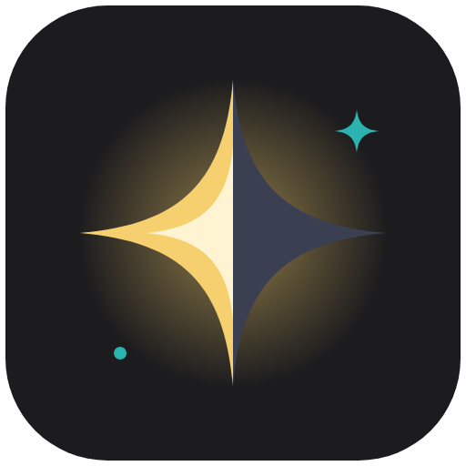

<p align="center">
  
</p>

<h1 align="center">Shadowstar XIV</h1>

<p align="center">
  
  
  <a href="https://github.com/ShadowstarIO/xiv/actions/workflows/sync.yml"></a>
</p>

<p align="center">
  <em>FFXIV plugins by Shadowstar, in one catalog.</em>
</p>

<p align="center">
  <a href="https://github.com/ShadowstarIO/AndThen"></a>&nbsp;
  <a href="https://github.com/ShadowstarIO/LightsOn"></a>&nbsp;
  <a href="https://github.com/ShadowstarIO/StatusShift"></a>&nbsp;
  <a href="https://github.com/ShadowstarIO/Starflow"></a>&nbsp;
  <a href="https://github.com/ShadowstarIO/Umbra.Candybars"></a>&nbsp;
  <a href="https://github.com/ShadowstarIO/Umbra.Horizon"></a>
</p>

<p align="center">
  <a href="#dalamud"><b>Dalamud plugins</b></a> ·
  <a href="#umbra">Umbra plugins</a> ·
  <a href="https://shadowstar.io">shadowstar.io</a>
</p>

---

Plugin list for [Shadowstar](https://shadowstar.io) FFXIV plugins. Dalamud plugins install from `repo.json`. Umbra plugins install from their own GitHub releases. Source stays in each plugin repo.

## Dalamud

In game: `/xlsettings` → **Experimental** → **Custom Plugin Repositories**, add:

```
https://raw.githubusercontent.com/ShadowstarIO/XIV/main/repo.json
```

Save, then `/xlplugins`. Search **LightsOn**, **StatusShift**, **Starflow**, or **AndThen**. AndThen is testing only until a stable release, so turn on testing builds in the plugin installer to see it.

Do not also add each plugin’s own `repo.json`. Same `InternalName` in two catalogs duplicates in the installer.

The old `XozaShadow/XIV` URL still redirects. Use this one going forward.

| Plugin | What | Source |
| --- | --- | --- |
| **AndThen** | When conditions match, apply settings and run commands. Testing only. | [AndThen](https://github.com/ShadowstarIO/AndThen) |
| **LightsOn** | Occupancy for listed venues and short outdoor scenes | [LightsOn](https://github.com/ShadowstarIO/LightsOn) |
| **Starflow** | When the realm changes, your setup follows: zone, duty, party, chat, and more drive settings, commands, mods, and travel. Pre-release. | [Starflow](https://github.com/ShadowstarIO/Starflow) |
| **StatusShift** | Online status, search comment, and commands from zone, activity, and schedule | [StatusShift](https://github.com/ShadowstarIO/StatusShift) |

Zips come from each plugin’s GitHub Releases. This file only points at them.

A scheduled Action refreshes `repo.json` from those repos. Run **Sync plugin catalog** on Actions if a release just dropped and the list is stale.

## Umbra

These are toolbar plugins, not Dalamud plugins. In Umbra: **Settings → Plugins**, then add the owner and repository. Umbra installs the latest GitHub release.

| Plugin | What | Owner | Repository |
| --- | --- | --- | --- |
| **Candybars** | One bar per person. Stack them into a party, target, or raid HUD. | `ShadowstarIO` | `Umbra.Candybars` |
| **Horizon** | One compass strip: heading, map icons, world markers, weather, and distance. | `ShadowstarIO` | `Umbra.Horizon` |

- [Candybars](https://github.com/ShadowstarIO/Umbra.Candybars)
- [Horizon](https://github.com/ShadowstarIO/Umbra.Horizon)
